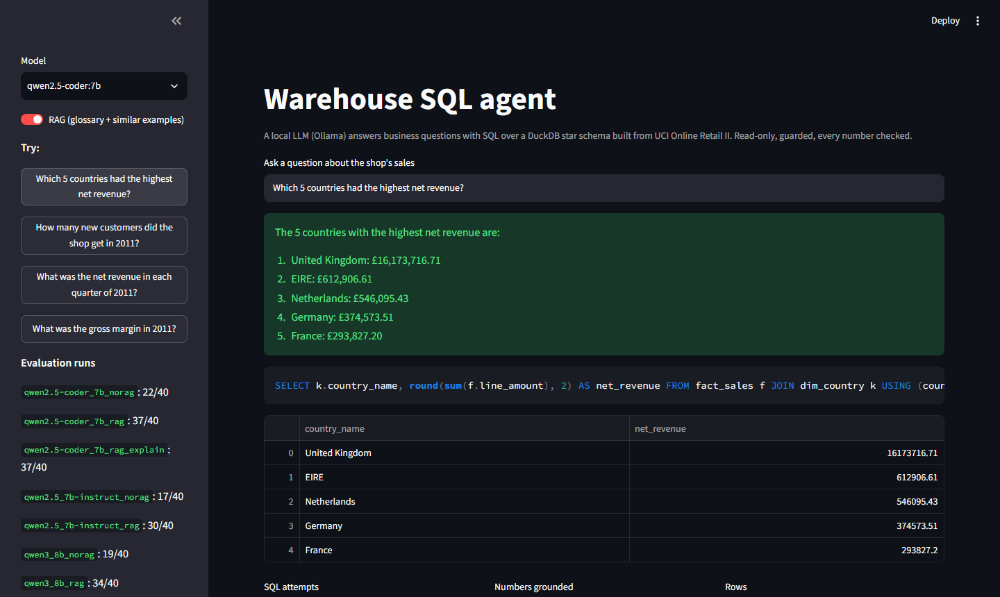

# warehouse-sql-agent

A local LLM answers business questions by writing SQL over a small **DuckDB star schema**, with
**guardrails**, **RAG** over a metric glossary and similar solved questions, a **number
grounding check** on the prose answer, and an **execution-based evaluation** on 40 questions
(including 10 that the data cannot answer and must be refused).

Everything runs locally on a 6 GB laptop GPU through [Ollama](https://ollama.com); no API key.



## Results

40 questions, 4 categories of 10. A question counts as correct when the result of the agent's
query matches the result of the gold query (row order, column names and extra columns ignored,
numbers to 2 decimals); a trap question counts as correct only when the agent refuses.
Generated by `scripts/summarize_runs.py` from the per-question logs in `eval/runs/`.

| model | RAG | correct | simple | join | time | trap (refused) | false refusals | SQL repairs | median s/question |
|---|---|---|---|---|---|---|---|---|---|
| qwen2.5-coder:7b | no | **22/40** | 6/10 | 5/10 | 3/10 | 8/10 | 0 | 3 | 6.1 |
| qwen2.5-coder:7b | yes | **37/40** | 9/10 | 8/10 | 10/10 | 10/10 | 1 | 1 | 8.6 |
| qwen2.5:7b-instruct | no | **17/40** | 7/10 | 3/10 | 5/10 | 2/10 | 0 | 3 | 6.1 |
| qwen2.5:7b-instruct | yes | **30/40** | 9/10 | 8/10 | 8/10 | 5/10 | 0 | 2 | 8.5 |
| qwen3:8b | no | **19/40** | 6/10 | 4/10 | 4/10 | 5/10 | 0 | 3 | 8.5 |
| qwen3:8b | yes | **34/40** | 10/10 | 8/10 | 10/10 | 6/10 | 0 | 3 | 12.4 |

With prose answers on (best configuration, `--explain`): 37/40 correct, and **29/29** prose
answers passed the number check (no fallback to the raw table was needed).

What the numbers say:

- **RAG is worth +13 to +15 questions for every model.** Part of that is plain domain
  knowledge rather than better SQL: without the glossary a model cannot know that an "order"
  excludes cancellation invoices or that guests share one `UNKNOWN` customer row. That is the
  point - business definitions belong in retrievable context, not in the model.
- **The code model wins**: qwen2.5-coder:7b with RAG gets 37/40 and refuses all 10 traps.
  The general models write similar SQL but answer traps such as "net revenue in 2015" or
  "which salesperson closed the most orders" with a query instead of a refusal.
- **Typical remaining errors** (see `eval/runs/*.jsonl`): `count(*)` instead of
  `count(DISTINCT invoice_no)`; an average over invoice lines instead of per customer; a typo in
  a string literal (`'T-LIGHTHOLDER'`) that silently returns NULL; a HAVING clause that could not
  be repaired in one attempt.

## How it works

```
question --> retrieve (bge-m3, DuckDB)          glossary.md + examples.jsonl
         --> plan: LLM returns JSON {sql, refuse, reason}   (Ollama structured output)
         --> guard: one SELECT only, LIMIT, read-only, no file access, timeout
         --> run on warehouse.duckdb  --(error)--> one repair with the error message
         --> explain: LLM writes 1-3 sentences from the result table
         --> grounding check: every number must come from the result (or the question)
             --(fails)--> one rewrite --(fails again)--> show the result table instead
```

| module | what it does |
|---|---|
| `wsa/warehouse.py` | cleans the UCI extract and builds `fact_sales` + `dim_product`, `dim_customer`, `dim_country`, `dim_date` |
| `wsa/guard.py` | DuckDB's own parser (no regex blacklist), single SELECT/WITH, outer LIMIT, `read_only` + `enable_external_access=false`, timer + `interrupt()` |
| `wsa/retriever.py` | glossary sections and few-shot examples, cosine similarity in a separate `rag.duckdb` so model SQL never sees the vectors |
| `wsa/agent.py` | plan / repair / explain / rewrite loop, structured JSON for refusals |
| `wsa/grounding.py` | extracts `£1,234.56`, `12.5%`, `1.2M`; tolerance follows the written precision |
| `wsa/matching.py` | execution-based result comparison |
| `wsa/evaluate.py` | per-category scores, false refusals, resumable JSONL logs |

### Data

[UCI Online Retail II](https://archive.ics.uci.edu/dataset/502/online+retail+ii): a UK online
gift shop, 2009-12-01 to 2011-12-09, 1,067,371 raw invoice lines. Cleaning: exact duplicates
(the two yearly sheets overlap) and non-product codes (postage, fees, manual adjustments)
removed, zero prices removed, cancellations kept with a flag so net revenue is a plain sum,
guest checkouts kept on one `UNKNOWN` customer row so inner joins never drop revenue. Result:
1,021,579 fact rows, 4,917 products, 5,877 customer rows, 43 countries, 739 days.

### Guardrails, tested

- `DROP`, `INSERT`, `COPY`, `ATTACH`, `SET`, `PRAGMA` and stacked statements are rejected before
  execution; `read_csv('C:/...')` is blocked by the connection itself.
- Queries are wrapped in `SELECT * FROM (...) LIMIT 200` and interrupted after 15 s.
- An invented number in the prose (`£999` when the result says `130.25`) triggers a rewrite,
  then a fallback to the table.

### Engineering notes

- Built test-first: 99 pytest tests at the public seams (warehouse, guard, matching,
  grounding, retriever, agent with a scripted fake LLM, evaluation); the gold SQL of every
  question is itself tested against the real warehouse, and few-shot examples are checked not
  to leak evaluation questions.
- On a 6 GB GPU Ollama swaps the embedding model and the chat model when calls alternate
  (~90 s per question). Embedding all questions in one batch first brought it to ~8 s.

## Run it

```bash
python -m venv venv && venv/Scripts/pip install -e ".[dev]"     # Python 3.11
ollama pull qwen2.5-coder:7b && ollama pull bge-m3
python scripts/build_warehouse.py          # downloads the UCI zip if needed (~1 min to read)
python -m wsa.cli index                    # RAG index
python -m wsa.cli ask "Which 5 countries had the highest net revenue?"
python -m wsa.cli eval --model qwen2.5-coder:7b [--no-rag] [--explain]
python scripts/run_all_evals.py            # the full grid above (~1 h on a GTX 1660)
streamlit run app.py
pytest
```

## Limitations and next steps

- An empty or all-NULL result (e.g. a year outside the data) should end in "no data for that
  period" instead of relying on the model to refuse.
- Fuzzy matching of string literals against dimension values would fix the typo class of errors.
- 40 questions is a small benchmark; the next step is more questions per category and several
  seeds to measure variance.

## PL - w skrócie

Agent zamienia pytania biznesowe na SQL nad hurtownią w DuckDB (schemat gwiazdy z UCI Online
Retail II), działa lokalnie na Ollamie, ma zabezpieczenia (tylko jeden SELECT, tylko odczyt,
limit wierszy i czasu), RAG ze słownika metryk i przykładów oraz walidację liczb w odpowiedzi.
Ewaluacja na 40 pytaniach, w tym 10 pułapek, które trzeba odrzucić: najlepszy wariant
(qwen2.5-coder:7b + RAG) - 37/40, RAG daje +13 do +15 pytań dla każdego modelu.

## License

MIT
